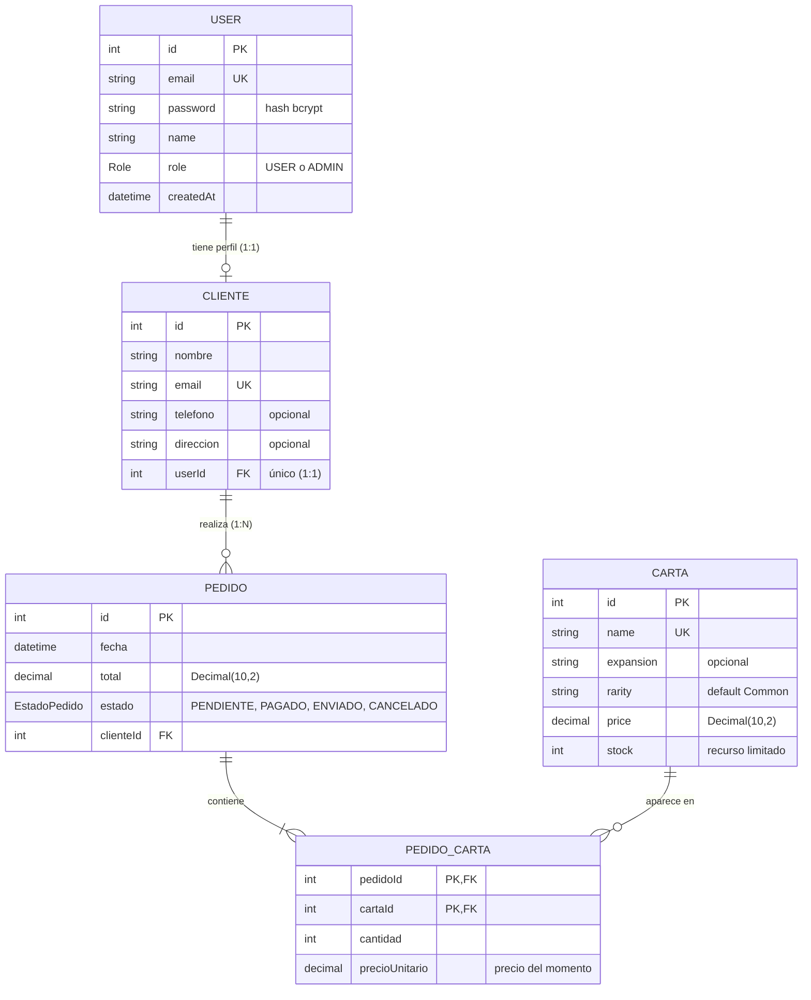

# Modelo ER del emprendimiento · Grupo G04

> Base del `schema.prisma` del Lab 3 (relaciones 1:1, 1:N y N:M).

## Diagrama

## Relaciones y onDelete

| Relación | Cardinalidad | FK | onDelete | Por qué |
|---|---|---|---|---|
| User – Cliente | 1:1 | `clientes.user_id` (única) | Cascade | El perfil de cliente no tiene sentido sin su cuenta: si se borra el usuario, se borra su perfil. |
| Cliente – Pedido | 1:N | `pedidos.cliente_id` | Restrict | No se borra un cliente que tiene compras: los pedidos son el historial de ventas de la tienda. |
| Pedido – PedidoCarta | 1:N (lado de la N:M) | `pedido_cartas.pedido_id` | Cascade | Las líneas de un pedido no existen sin el pedido: si se borra el pedido, se borran sus líneas. |
| Carta – PedidoCarta | 1:N (lado de la N:M) | `pedido_cartas.carta_id` | Restrict | No se borra una carta que ya se vendió (la API responde 409); para retirarla se deja con stock 0. |

La relación **Pedido N:M Carta** es explícita (tabla `pedido_cartas`) porque guarda datos propios: `cantidad` y `precioUnitario` (el precio de la carta al momento de la compra).

## Mapeo

- Enums: `Role` (USER, ADMIN) y `EstadoPedido` (PENDIENTE, PAGADO, ENVIADO, CANCELADO).
- Dinero con `Decimal(10,2)`: `price`, `total` y `precioUnitario`. Fechas con `DateTime`: `fecha` y `createdAt`.
- Índices: `@@index([clienteId])`, `@@index([estado, fecha])` y `@@index([expansion, rarity])`; clave compuesta `@@id([pedidoId, cartaId])`.
- Nombres en snake_case con `@map` y `@@map` (`created_at`, `cliente_id`, `pedido_cartas`…).

## ¿Qué se implementa en cada laboratorio?

- **Lab 2:** Carta y Cliente sin relaciones.
- **Lab 3:** User, Pedido, PedidoCarta y todas las relaciones.