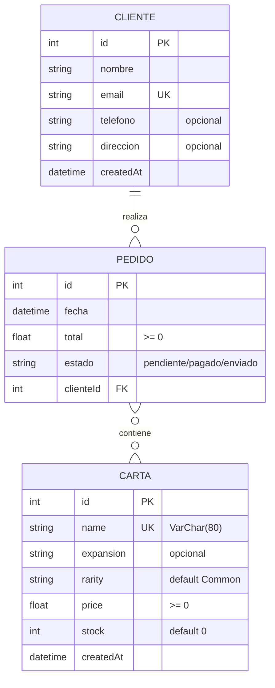

# Modelo ER del emprendimiento · Grupo G04

# Grupo G04

> Actividad 3 de la sesión 4. Es la base del `schema.prisma` del Lab 2 y de las relaciones del Lab 3.

## Diagrama

## Entidades

| Entidad | Atributos (tipo) | Clave primaria | Únicos / obligatorios / reglas |
|---|---|---|---|
| Carta | name(string), expansion (string), rarity (string), price (float), stock (int), createdAt (datetime) | id (int, autoincremental) | name único y obligatorio (>= 3 caracteres); price >= 0; stock entero >= 0; expansion opcional |
|Cliente | nombre (string), email (string), telefono (string), direccion (string), createdAt (datetime) | id (int, autoincremental) | email único y obligatorio; nombre obligatorio; telefono y direccion opcionales | |
| Pedido | fecha (datetime), total (float), estado (string), clienteId (int, FK) | id (int, autoincremental) | total >= 0; estado obligatorio; clienteId debe existir en Cliente |

## Relaciones

| Entidad A | Cardinalidad (1:1, 1:N, N:M) | Entidad B | Ejemplo en una frase |
|---|---|---|---|
| Cliente | 1:N | Pedido | Un cliente realiza muchos pedidos; cada pedido pertenece a un solo cliente |
| Pedido | N:M | Carta | Un pedido contiene varias cartas y una carta puede estar en muchos pedidos (Lab 3: tabla intermedia). |

## ¿Qué se implementa en cada laboratorio?

- **Lab 2:** Carta y Cliente sin relaciones.
- **Lab 3:** Pedido y las relaciones.
