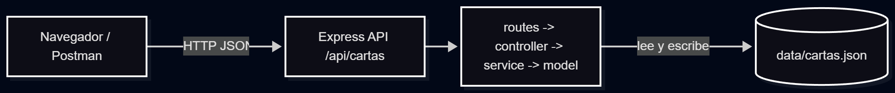

# Propuesta del emprendimiento · Grupo G04

> Actividad 1 de la sesión 1. Complétala antes del Paso 1 del laboratorio.

|          Campo            |               Respuesta                   |
|---|---|
| Nombre del emprendimiento | Tienda de cartas Pokémon (Tienda Pokémon) |
| Problema que resuelve     | Los coleccionistas compran cartas en grupos de redes sociales sin catálogo, precios claros ni control de stock.                                                                  |
| Usuarios (quién lo usa)   | Coleccionistas y jugadores (compran) y el administrador de la tienda (gestiona el catálogo).                      |
| 3 funciones principales   | 1. Gestionar el catálogo de cartas (CRUD) 2. Registrar clientes 3. Crear pedidos de compra                 |

## Mapa frontend–backend

Pega aquí la imagen del diagrama (Excalidraw o Mermaid): navegador → servidor → base de datos, con sus flechas.

## Entidades (3) y atributos principales

|    Entidad    |                 Atributos                  |              ¿Se relaciona con…?                 |
|---|---|---|
| Carta (Lab 1) | id, name, expansion, rarity, price, stock  | Pedido (una carta puede estar en muchos pedidos) |
| Cliente       | id, nombre, email, telefono, direccion     | Pedido (un cliente tiene muchos pedidos)         |
| Pedido        | id, clienteId, fecha, total, estado        | Cliente y Carta                                  |

> La primera entidad es la que implementan en este laboratorio (4 o más campos). Las otras dos se usan en los Labs 2 y 3.

## 3 endpoints iniciales

| Verbo |     Ruta     | Código de estado |
|---|---|---|
| GET   | /api/cartas  |       200        |
| POST  | /api/cartas  |       201        |
| POST  | /api/pedidos |       201        |
