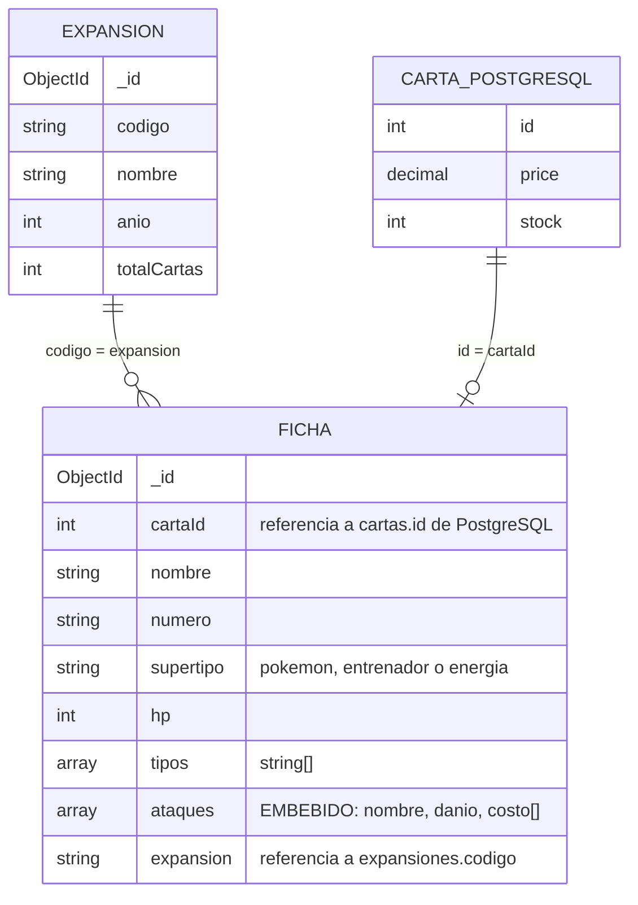

# Hito 2 · Workload y modelo documental

**Grupo:** G04  **Emprendimiento:** Tienda de cartas Pokémon  **Colección elegida (hito 1):** fichas

## 1. Workload

| Actor | Operación | Lectura o escritura | Frecuencia (por día/hora) | Datos que usa |
|---|---|---|---|---|
| Cliente (coleccionista) | Ver la ficha en el detalle de una carta | Lectura | ~500 por día | Ficha completa con ataques |
| Cliente | Filtrar el catálogo por tipo o supertipo (ej. todas las de fuego) | Lectura | ~200 por día | tipos, supertipo, nombre, numero |
| Administrador | Registrar la ficha de una carta nueva | Escritura | ~10 por día (más al salir una expansión) | Ficha completa |
| Administrador | Corregir un dato de una ficha (HP, ataque mal escrito) | Escritura | ~2 por día | Un campo puntual |

**Conclusión:** hay muchas más lecturas que escrituras y la ficha casi siempre se lee completa, por eso conviene que todo lo de una ficha esté en un solo documento.

## 2. Relaciones: embeber o referenciar

| Relación | Cardinalidad | ¿Se lee junto? | ¿Cambia seguido? | ¿Crece sin límite? | Decisión |
|---|---|---|---|---|---|
| Ficha – Ataques | 1:N (1 a 4) | Sí, siempre | No | No (máximo 4) | Embebida |
| Expansión – Fichas | 1:N (cientos de fichas por expansión) | A veces | Rara vez, pero la comparten muchas fichas | Sí (cada expansión trae 100 a 200 cartas) | Referenciada (campo expansion = codigo) |
| Carta (PostgreSQL) – Ficha | 1:1 | Sí, en el detalle | Precio y stock cambian seguido | No | Referenciada por cartaId (vive en otra base) |

## 3. ER de MongoDB

Lo embebido se dibuja DENTRO de la entidad (`ataques`); lo referenciado, como caja aparte unida con una línea.

## 4. Playground (`grupo4.mongodb.js`)

- [x] `createCollection` con `$jsonSchema`: 1 `enum`, 1 rango (`minimum`/`maximum`) y 1 arreglo
- [x] 2 inserts válidos y 2 rechazados (con el mensaje)
- [x] `$lookup` entre dos colecciones